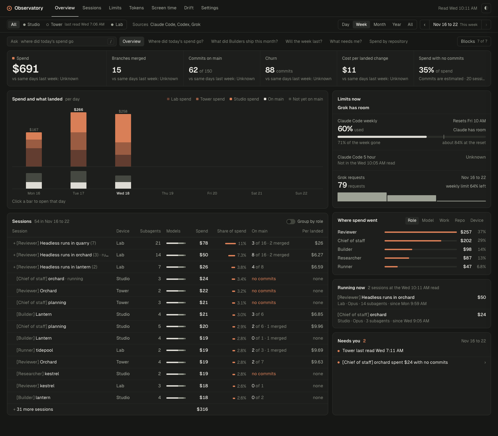
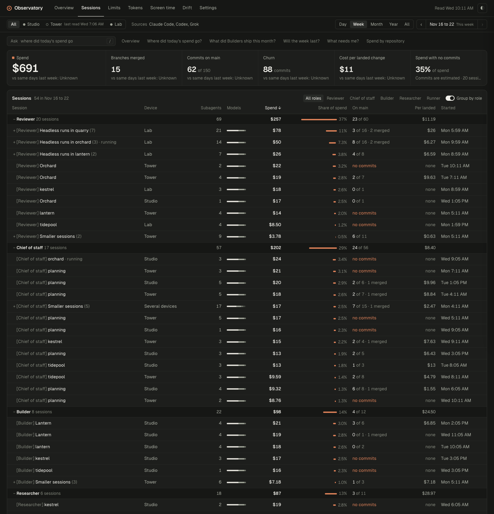
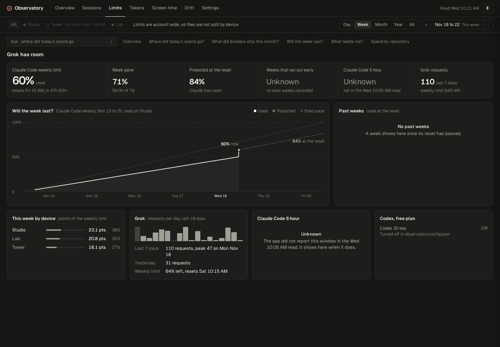
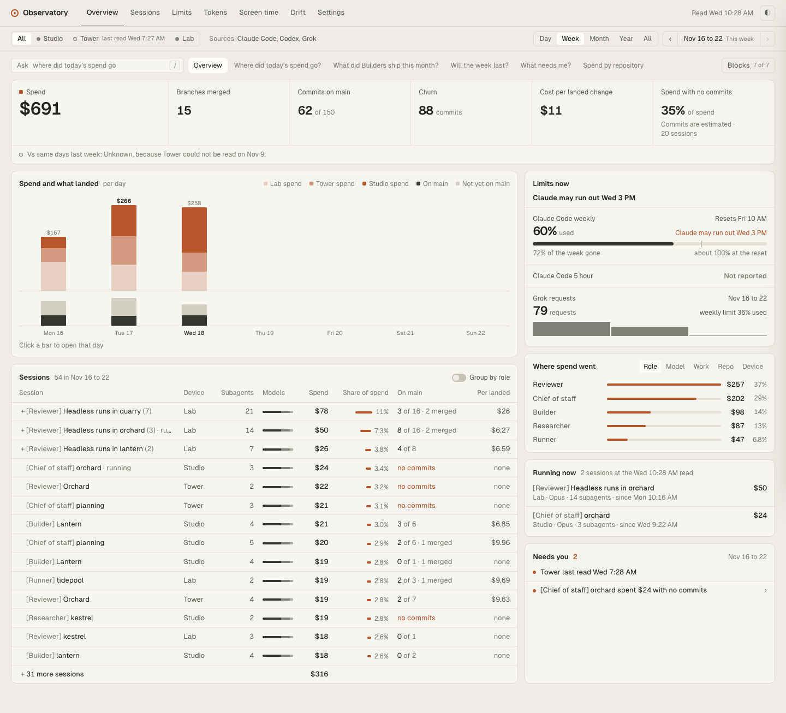

<p align="center"><picture><source media="(prefers-color-scheme: dark)" srcset="glance/icons/png/icon-128-dark.png"></picture></p>

# Observatory

A menu bar app and local dashboard for people who run coding agents such as Claude Code and Codex on a plan with usage limits. It shows which sessions used this week's limit, what each one shipped, and when each limit runs out at your current pace, for example "Claude runs out Wed 3–7 PM at this pace." A year of history is one click away. It runs on a Mac, a Windows PC, a Linux computer or any mix.

Observatory reads records your tools already keep on your computer. It has no account, no hosted service and no telemetry. It only watches: it does not start, stop or answer an agent, and it does not change the tools it reads.

<p align="center"></p>

<p align="center"> </p>

<p align="center"></p>

The screenshots use the fictional sample data from `npm run preview`.

The dashboard has seven views under one scope bar. The scope bar picks the computers, the period (a day, week, month, year or all of it, stepped back and forward) and shows which sources have data. The address keeps the scope, so a view can be bookmarked.

- **Overview** shows spend at API prices, branches merged, commits on main, commits not yet on main, cost per landed change and spend with no commits, each compared with the same days of the previous period. Every number opens into its parts by computer, role, session, repository, model or kind of work. Below them are spend per day over what landed, the largest sessions, Limits now, what is running and a few lines that need you.
- **Sessions** lists every session as "[Builder] Lantern": a role and what it worked on, with its computer, models, subagents, spend and commits on main. Recurring runs, three or more in the period with the same role and the same object in their titles (a scheduled queue runner, for example), fold into one row that opens into its runs, and so do headless runs of one role and repository. The role comes from a `Role:` prefix in the title, your own `sessions.roles` map, how the session ran, or the kind of work it did.
- **Limits** leads with the same forecast sentence as the menu bar, then each limit window once, with the computer it was read on, how much of the window is gone, past weeks and Grok requests.
- **Tokens**, **Screen time**, **Drift** and **Settings** show tokens by model and kind, time at the screen, model settings that differ between computers, and each computer's sources. Settings only shows them: change them in `observatory.config.json` on that computer.

The Ask field and the pinned questions ("Where did today's spend go?", "Will the week last?") rearrange the same blocks. Nothing in the dashboard calls a model. The menu bar and tray icon is a telescope whose tube fills for the share of the Claude weekly limit used. The star it points at is a dot when the limit lasts until the reset at this pace, a bar when it runs out first and a hollow dot when the last read is old. An empty tube with no star means the limit is off. On a Mac the percent used sits beside the icon, and on Windows it leads the tray tooltip. The panel behind it shows the scarcer limit, what is running now and the top flag.

## Install

You need [Node.js](https://nodejs.org/) 22.13 or later on a Mac, or 22.17 or later on Windows. On a Mac, also run `xcode-select --install`. For screen time, install and run [ActivityWatch](https://activitywatch.net/). Everything else is optional.

```bash
git clone https://github.com/ScribleSean/observatory.git
```

```bash
cd observatory
```

```bash
npm run setup
```

Setup writes a settings file if there is none, builds the dashboard and a small menu bar app (a tray app on Windows) inside the cloned folder, and starts it now and at login. Click the telescope icon, then **Open dashboard**. The dashboard runs at http://127.0.0.1:5601. It listens on 127.0.0.1 only and accepts only GET and HEAD requests.

- Preview the changes first with `npm run setup -- --dry-run`.
- Update with `git pull`, then `npm run setup`.
- Remove with `npm run setup -- --remove`, then delete the folder. History lives in `~/Library/Application Support/Observatory` on a Mac and `%LOCALAPPDATA%\Observatory` on Windows.
- On Linux, setup builds nothing and has no menu bar app. It installs a systemd user timer that collects every five minutes, or prints one crontab line when systemd is not available. `npm run setup -- --dry-run` shows the files first.
- If the notch hides the menu bar item on a MacBook, hold Command and drag it right.

## How it works

Every five minutes the app collects one snapshot of this computer:

| Source | Read from | Kept |
| --- | --- | --- |
| Limits | The installed Claude Code and Codex clients, with your existing sign-in | Percent left and reset time per window |
| Claude Code | `~/.claude/projects` | Tokens per day, hour and model. Per session: its title, start and end, tokens and models, subagent counts and their kind of work (from the subagent's own type and description), and the names of the repositories it wrote to. Cache reads are counted separately and left out of the headline |
| Codex | `~/.codex` | Tokens per day and model, effort and speed settings, tool call counts, and the same per-session facts as Claude Code where Codex records them |
| Commits | The local git repositories a session wrote to | Commit counts per session and whether they reached the default branch. A commit counts for the session that last wrote in that repository in the 20 minutes before it, so these are estimates: a commit pulled in, or made by hand in that time, can count too |
| Screen time | ActivityWatch on 127.0.0.1 | Seconds per app and category |
| Grok (optional) | The Grok Bot app's own cached weekly reading, and a request log you name | Percent left and reset time, and requests per day |

The snapshots and the dashboard hold no prompts, responses, commands, window titles, paths or credentials. Session titles are kept so the dashboard can name sessions. With several computers they travel to the hub over your own SSH connection. Set `"sessions": { "titles": false }` to keep only a short hash instead, keyed with a secret that never leaves the computer. Each session also keeps whether it ran interactively or headless, the kind of its first prompt (such as review or build, never the prompt itself) and the folder name of the git repository it ran in. A working folder that is not a git repository is not kept. These three are kept with titles off too, and name untitled sessions. The daily history behind the views keeps, per computer, tool and day, the totals, the spend split by model, kind of work, how sessions ran and repository folder name, and the 30 largest sessions with a hashed id. Commit ids stay in a private store on that computer and never enter a snapshot. A private cache in the data folder holds file locations so the collector can resume reading where it stopped. It never leaves the computer. [SECURITY.md](SECURITY.md) has the details. A value that could not be read shows as Unknown, not as zero. Each computer works out the forecast once per reading, and the dashboard, menu bar, tray and status all show those same stored words. The forecast uses each limit's pace over the last hour and its average pace since the limit last reset. Once a few days of readings are stored, it also gives a range, taken from how far its own earlier forecasts missed, for example "Claude may run out Thu 3–6 PM." `node scripts/harness/forecast-backtest.mjs --fictional` replays the forecast over made-up readings and prints how far it missed, and `--db` does the same over your own stored readings. Dollar figures are estimates at public API prices, not a bill.

An engine reads **Off** instead of showing an old number when its client is signed out, when the account reports a free plan, or when it has had no reading for a day. When Claude Code is signed out, the menu bar icon reads **Sign in** and names the computer. A reading from a computer that is off never stands in for one that is up. **Refresh** in the panel reads every source again, and opening the panel on a reading more than a minute old does the same.

History goes back to the first day each source has data and is kept until you delete the data folder. Token counts are saved per day, so a day stays counted after Claude Code deletes its old transcripts.

**Several computers.** A Mac, a Windows PC and a Linux computer can share one view. The hub reads each other computer's snapshot over your own SSH alias and sends the combined view back, so every computer shows all of them. A Linux computer, such as a headless server where agents run, collects tokens, limits and sessions and has no screen time or tray app. Limits are account-wide and are not added across computers. Token and screen time sums are labeled "not deduplicated". To turn a computer off, set `"off": true` on its entry under `hub.spokes`: the hub stops reaching it and every surface shows it as Off. See [Several computers](docs/SEVERAL-COMPUTERS.md).

## Settings

`observatory.config.json`, next to `package.json`:

```json
{
  "device": { "name": "Mac" },
  "sources": {
    "screenTime": true,
    "codex": true,
    "codexLimits": true,
    "claudeCode": true,
    "claudeLimits": true
  }
}
```

A source is read only while it is `true`. Run `npm run setup` after a change. Optional: `dashboard.port` (default 5601), `dataFolder`, `codexPath`, and `"glance": { "accent": true }` to draw the Mac menu bar icon in the accent color instead of the system's monochrome.

**Engines.** `engines` sets each tile to `"auto"` (the default), `"off"`, or `"on"` (keep a free plan's own allowance on screen): `"engines": { "codex": "off" }`. With several computers, set it in each settings file: each one draws its own tiles.

**Grok.** Set `"grokLimits": true` under `sources` and point `grok` at local files. Both are optional; nothing is sent anywhere.

```json
"grok": {
  "appFolder": "/absolute/path/to/the/Grok Bot app data folder",
  "requestLog": "/absolute/path/to/requests.jsonl"
}
```

`appFolder` gives the weekly limit the app last read, which counts as current until the app's own expiry (at most a day). `requestLog` is one JSON object per line with an ISO time in `at`; only the count per day is kept. With a log and no limit, the tile shows today's requests and no percent. Without `sources.grokLimits` or either path there is no Grok tile. A limit reading older than a day stops counting.

On a Windows PC, set `"wsl": true` under `sources` to also count the Claude Code and Codex logs inside WSL toward that PC. See [Several computers](docs/SEVERAL-COMPUTERS.md#wsl-on-the-pc).

## Ask Claude for a view (optional)

An optional MCP server, `scripts/mcp-server.mjs`, lets your own Claude client compose a dashboard view from a question and save it. A saved view holds only block names and queries, never numbers or session titles, and the server cannot read your usage, makes no network calls and writes only into `public/local/views` in your data folder. The dashboard lists saved views next to the pinned questions. See [Compose dashboard views](docs/MCP.md).

## Agent status

`npm run status -- --json` prints each engine's limits for scripts and agents: percent left, reset time, burn rate and pace per window, the engine with the most room, and when an engine that is out comes back. It reads this computer's `combined.json` only, makes no network calls and writes nothing.

```bash
npm run status -- --wait codex --timeout 60
```

That waits up to 60 minutes for Codex to have room again. Exit codes: 0 for a current reading, 3 for missing or stale data, 4 on a wait timeout, and 2 for a bad engine name or timeout. [Agent status](docs/AGENT-STATUS.md) lists every field.

## Development

```bash
npm ci
```

```bash
npm test
```

`npm run tick` runs one collection. After `npm run build`, `npm run preview` serves the dashboard with fictional data at http://127.0.0.1:5602. Bug reports and small fixes are welcome. See [CONTRIBUTING.md](CONTRIBUTING.md) and [SECURITY.md](SECURITY.md).

[MIT license](LICENSE) · [Third-party notices](THIRD-PARTY-NOTICES.md)
