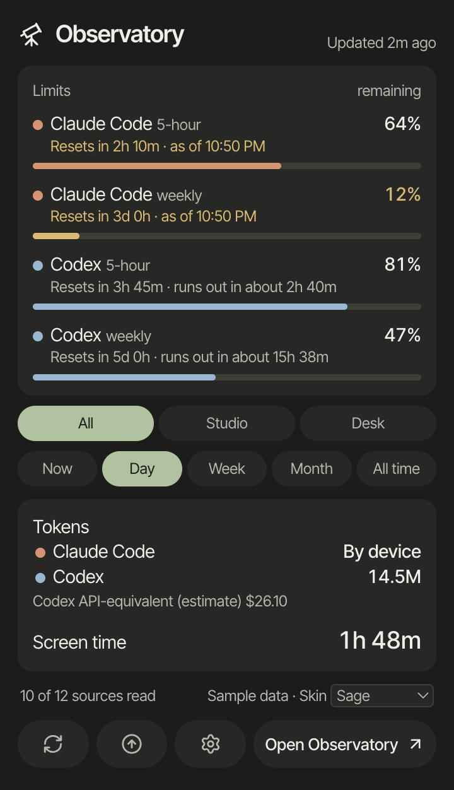
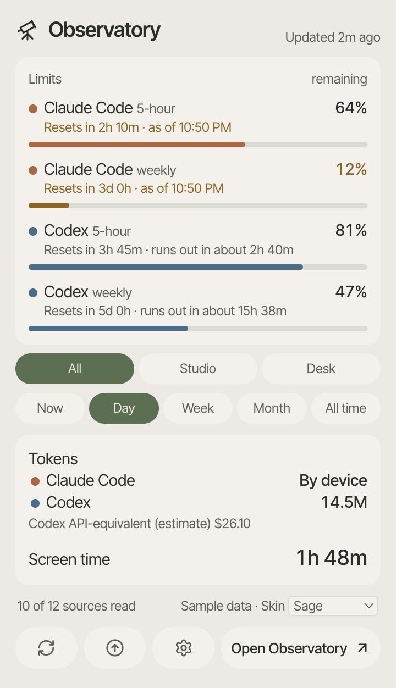

  
  <h1>Observatory</h1>
  
A Mac menu-bar and Windows tray app that shows your Claude Code and Codex limits, your token usage and your screen time.

  

    <a href="docs/MAC.md">Install on a Mac</a>
    &nbsp; · &nbsp;
    <a href="docs/WINDOWS.md">Install on Windows</a>
    &nbsp; · &nbsp;
    <a href="docs/GUIDE.md">Guide</a>
    &nbsp; · &nbsp;
    <a href="docs/GUIDE.md#development">Build from source</a>
  

  
  

The panel with sample data.

## What it shows

- How much of each Claude Code and Codex limit is left, when it resets and how fast it is being used.
- Claude Code and Codex tokens by day and model, with an estimate of what the same tokens would cost at public API prices.
- Screen time by app category, read from [ActivityWatch](https://activitywatch.net/).
- Dictation statistics from Wispr Flow, if you turn that source on.
- Which sources were read and when.

You can filter by device and by period: Now, Day, Week, Month and All time.

The menu-bar or tray panel shows the limits, the totals for the chosen device and period, and buttons to refresh, check for updates, open Settings and open the full window. The full window has six sections: Limits, Activity, Tokens, Dictation, Sources and Settings. Dictation appears only when a dictation source is on. The Mac and Windows apps show the same pages, and Settings offers four skins.

Observatory runs on your computer. It has no account and no hosted service. It reads records that other tools already keep, and it makes no model requests.

## Platforms

| | Mac | Windows |
| --- | --- | --- |
| System | macOS 14 or later, Apple Silicon | Windows x64 |
| Download | A ZIP that holds `Observatory.app` | A per-user installer that needs no administrator rights |
| Install guide | [Observatory on a Mac](docs/MAC.md) | [Observatory on Windows](docs/WINDOWS.md) |

Each source is optional. ActivityWatch must be installed and running for screen time. Codex and Claude Code must be installed on the device for their records. A source that is off or unavailable shows Unknown and does not block the others.

Builds are unsigned. macOS shows a security warning the first time you open the app, and Windows usually does too. The install guides describe each warning and the supported way to open the app without turning off the system protection.

<!-- F1: replace the next sentence with the demo link after the demo is published. -->
An interactive demo with fictional sample data is built from the same pages. Its link is added here when it is published.

## First run

On first launch the app opens a setup screen that asks which sources to read. Every source starts off, and nothing is collected until you finish setup. You can change the sources later in Settings. See the [guide](docs/GUIDE.md) and [source coverage](docs/SOURCE-COVERAGE.md).

If you used a development build from before the app was renamed to Observatory, move its data before you open the new app for the first time. The install guides describe the steps.

## Pairing a second device

Pairing a Mac and a Windows PC is optional, and a single device gets the complete app. To pair, install [Tailscale](https://tailscale.com/) on both devices and sign in to the same account. Then copy an invitation in Settings on the first device, paste it in Settings on the second, and confirm the pairing on both devices. Tailscale is used only to reach the other device. Trust comes from the invitation, and records travel directly between the two devices over an encrypted connection. Sharing Codex limits or Claude Code tokens with the other device needs consent on both devices. The devices connect on TCP port 43128 by default. If your tailnet's access rules restrict traffic, allow that port between your own two devices. The first time a device listens for the other one, the Mac firewall (when it is on) or Windows Firewall may ask whether to allow the app's bundled `node` runtime, and you need to allow it. See the [guide](docs/GUIDE.md#pair-two-devices).

## Data and privacy

- Records stay on your devices. The app stores daily and hourly totals and limit readings, not prompts, window titles, transcripts, commands or recordings.
- Provider sign-ins stay in their own apps. Observatory does not read, copy or store credentials.
- Reading limits asks the provider's own installed client for the account's current limits. Collection makes no other request to a provider.
- Paired devices exchange sanitized records directly. No record is sent anywhere else.

See [private sync](docs/PRIVATE-SYNC.md) and [security](SECURITY.md).

## How to read the numbers

- Unknown means a value was not read. It never means zero.
- A limit percentage comes from the provider. A dollar figure is an estimate at public API prices and is not a bill.
- Token counts include cached input. They do not tell you how much of a subscription is left.
- Screen time is foreground app time. It does not measure attention or output.
- Records from two devices are never added together unless the overlap check passes.

## Limitations

- Builds are not signed by an identified developer, and there are no automatic updates. Check for updates in the panel says that updates are not available in this build. To update, download the newer release and replace the app as the install guide describes.
- The Mac app runs only on Apple Silicon with macOS 14 or later. The Windows app runs only on x64. There is no Linux app, and WSL and Ubuntu tracking are out of scope. iPhone integration is later work and is not implemented.
- Claude Code limits are read only after you turn them on in Settings and accept the notes shown there. They are read by Claude Code's own usage command with its installed sign-in. They are account-wide and are not sent to a paired device. If Claude Code reports no limits for the account, they show as Unknown. When a new reading cannot be taken, the app shows the earlier reading with the time it was observed.
- Screen time needs ActivityWatch on each device you want to track. Observatory does not install it.
- Collection runs every five minutes while the app is running.
- Days are counted in the America/New_York time zone on every device.
- Claude Code tokens are shown per device. Codex tokens and screen time for both devices together appear only when the overlap check passes.
- On Windows, starting the app from inside a packaged app such as Claude desktop can make it refuse its private folders and read fewer sources. Start it from the Start menu. See the [Windows guide](docs/WINDOWS.md#start-the-app).

## Contributing

Bug reports with steps to reproduce and small fixes are welcome. Use synthetic examples, and never attach real usage records or account details. Read [AGENTS.md](AGENTS.md) for the project's boundaries before opening a pull request. [The design direction](docs/DESIGN.md) describes where the app is going, [the parity table](docs/PARITY.md) lists what each platform has, and [the state record](docs/STATE.md) lists what has been verified on which build.

[MIT license](LICENSE) · [Third-party acknowledgments](THIRD-PARTY-NOTICES.md)
