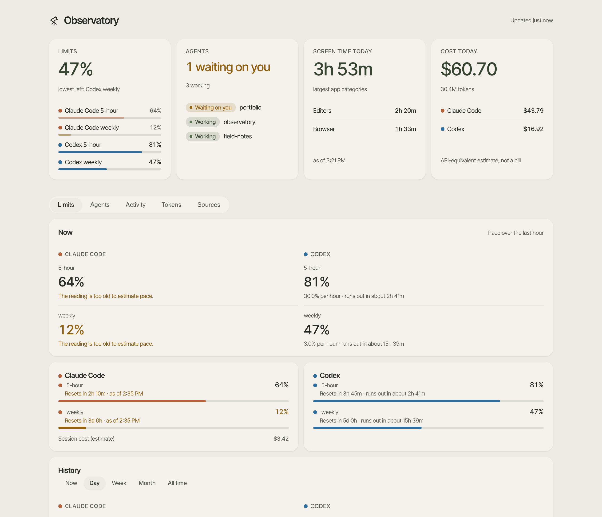
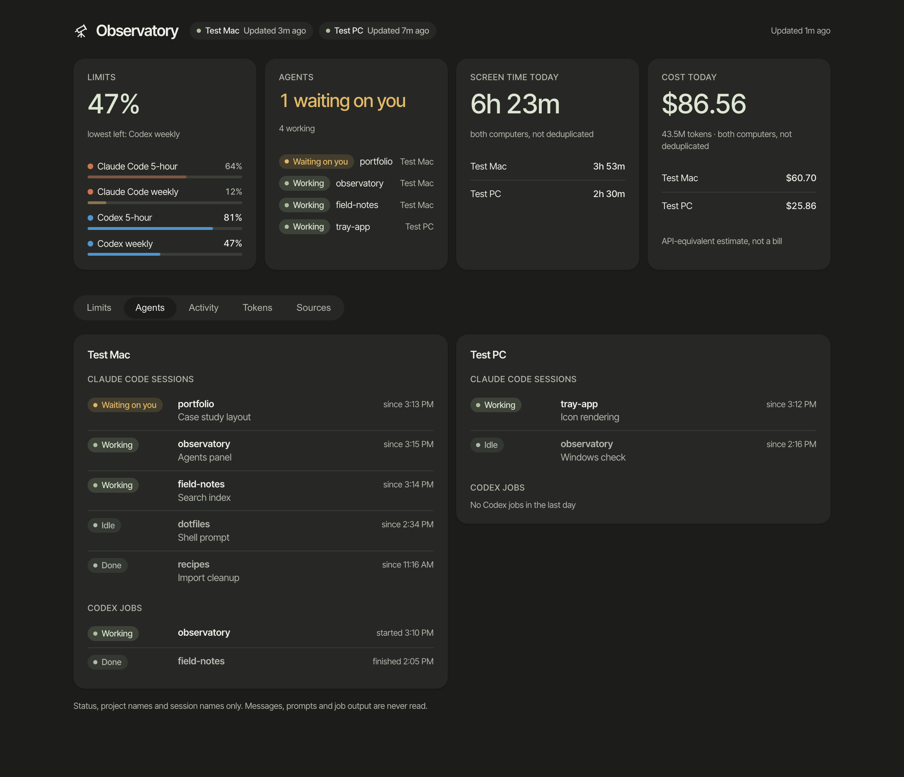

<div align="center">
  
  <h1>Observatory</h1>
  <p><strong>A calm menu bar companion for working with AI coding agents.</strong></p>
  <p>It watches your Claude Code and Codex limits, your agents, your screen time and your token costs, on your own computer, and never touches any of them.</p>
  <p>
    <a href="#quick-start">Quick start</a>
    &nbsp;·&nbsp;
    <a href="#privacy">Privacy</a>
    &nbsp;·&nbsp;
    <a href="docs/TWO-COMPUTERS.md">Two computers</a>
    &nbsp;·&nbsp;
    <a href="#development">Development</a>
  </p>
</div>

<p align="center">
  
</p>

## Four questions at a glance

| Question | What Observatory shows |
| --- | --- |
| **Am I near my limits?** | Claude Code and Codex, each window (5-hour and weekly): percent left, reset time and the pace you are using it at. The menu bar title is the lowest one. |
| **What are my agents doing?** | Each Claude Code session as working, waiting on you, idle or done, and recent Codex jobs, with project and session names. An amber dot in the menu bar means one is waiting on you. |
| **Where did my time go?** | Screen time today and over time, by app and category, from [ActivityWatch](https://activitywatch.net/). |
| **What did it cost?** | Tokens today and over time, and what they would cost at public API prices. |

Observatory is monitor-only. It never starts, stops or answers an agent, and it never changes the tools it reads.

## Quick start

You need [Node.js](https://nodejs.org/) 22.13 or later on a Mac or a Windows PC. On a Mac, also install the Xcode Command Line Tools with `xcode-select --install`. For screen time, install and run [ActivityWatch](https://activitywatch.net/). Everything else is optional: a source that is missing shows Unknown and the rest keep working.

```bash
git clone https://github.com/ScribleSean/observatory.git
```

```bash
cd observatory
```

```bash
npm run setup
```

That is the whole install. Setup writes a settings file with every source on, builds the dashboard and a small menu bar app (a tray app on Windows) inside the folder you cloned, and starts it now and at login. There is no account and no installer, and nothing goes into Applications or Program Files. Because the app is built on your own computer, there is no downloaded-app warning to click through.

Click the number in the menu bar, then **Open dashboard**. The dashboard runs at http://127.0.0.1:5601 in your normal browser.

- **Update:** `git pull`, then `npm run setup` again.
- **Remove:** `npm run setup -- --remove` stops the app and removes the login item. Then delete the cloned folder, and the data folder if you want the history gone: `~/Library/Application Support/Observatory` on a Mac, `%LOCALAPPDATA%\Observatory` on Windows.
- **Hidden menu bar item:** on a MacBook with a notch and a busy menu bar, hold Command and drag the item to the right.

## A second computer (optional)

If you work on a Mac and a Windows PC, they can share one view. The Mac reads the PC's numbers over your own SSH connection every five minutes and writes the combined view back, so both menus and both dashboards show both computers. Limits are never added, and sums of time and tokens are labeled "not deduplicated". See [Two computers](docs/TWO-COMPUTERS.md).

<p align="center">
  
</p>

## Privacy

Observatory reads records that your tools already keep on your computer. It sends nothing to any server of its own or anyone else's, and it has no telemetry.

| Source | What is read | What is kept |
| --- | --- | --- |
| ActivityWatch | App usage events from its local server on 127.0.0.1 | Seconds per app and category, by day and hour. No window titles. |
| Claude Code logs (`~/.claude/projects`) | Token counts per request | Tokens per day, hour and model. No prompts or responses. |
| Codex logs (`~/.codex`) | Token counts, settings and tool calls per session | Tokens per day and model, effort and speed settings, tool call counts by name. No prompts, responses or arguments. |
| Claude Code sessions (`~/.claude/sessions`) | Each running session's small status file | Status, project folder name, session name, times. Transcripts and key files are never opened. |
| codex-job (`~/.local/state/codex-jobs`, optional) | File names only | Project name, running or finished, times. Job output is never opened. |
| Limits | Asked from the Claude Code and Codex clients you already have | Percent left and reset time per window. |

- To read your limits, Observatory asks the installed Claude Code and Codex clients, which fetch your own account's limits from their provider with your existing sign-in. Observatory never sees or stores credentials.
- The dashboard listens on 127.0.0.1 only, serves one data file and has no way to change anything.
- With a second computer, the only other connection is SSH from your Mac to your own PC.
- The tests plant prompts, messages, job output, paths and fake keys in sample files and check that none of them reach the saved data.

Turn any source off by setting it to `false` in `observatory.config.json` and running `npm run setup` again. See [security](SECURITY.md) for details.

## Settings

Settings are in `observatory.config.json`, next to `package.json`. Setup writes it the first time.

```json
{
  "device": { "name": "Studio Mac" },
  "sources": {
    "screenTime": true,
    "codex": true,
    "codexLimits": true,
    "claudeCode": true,
    "claudeLimits": true,
    "agents": true
  }
}
```

A source is read only while it is `true`. Optional settings are `dashboard.port` (default 5601), `dataFolder`, and `codexPath` if Codex is installed somewhere unusual.

## How to read the numbers

- Unknown means a value was not read. It never means zero.
- A limit percentage comes from the provider. A dollar figure is an estimate at public API prices, not a bill.
- Days are counted in your computer's own time zone.

## Screenshots

The images in this README use fictional data from `npm run preview`. To retake them, run `npm run build`, then `npm run preview`, and open http://127.0.0.1:5602 for two computers (set `PREVIEW_ONE=1` for one). They are taken at 1280 pixels wide and 2x scale.

Shots already in the repository:

1. `docs/images/dashboard-one-computer-light.png`: one computer, Limits page, light.
2. `docs/images/dashboard-agents-dark.png`: two computers, Agents page, dark.
3. `docs/images/dashboard-{limits,agents,activity,tokens}-{light,dark}.png`: every page in both appearances.

Shots that need a real desktop, still to take:

4. Mac menu bar, closed: the telescope and the lowest percent, with the amber dot showing.
5. Mac menu bar, open: the Limits, Agents and Today sections, then Open dashboard, Refresh and Quit.
6. Windows tray icon with its number, and the tray menu open.
7. The dashboard beside a terminal running Claude Code, with one session waiting on you.

## Development

```bash
npm test
```

```bash
npm run lint
```

`npm run tick` runs one collection by hand. [The hub plan](docs/HUB-PLAN.md) maps the code to the design, and [the intro storyboard](docs/INTRO-STORYBOARD.md) describes a short product video.

| Part | Files |
| --- | --- |
| Settings | `lib/config.mjs`, `lib/timezone.mjs` |
| Readers | `scripts/read-settings.mjs`, `scripts/read-claude-usage.mjs`, `scripts/read-agents.mjs`, `scripts/mac-activity.mjs`, `scripts/windows-aggregate-activity.ps1`, `scripts/collect-quota.mjs`, `scripts/claude-limits.mjs` |
| Collect and combine | `scripts/collect.mjs`, `lib/combine.mjs`, `scripts/tick.mjs` |
| Second computer | `scripts/hub.mjs`, `scripts/hub-transport.mjs` |
| Dashboard | `serve-local.mjs`, `app/viewer`, `lib/panel-data.mjs` |
| Menu bar and tray | `glance/mac/Glance.swift`, `glance/windows/Glance.cs` |
| Setup | `scripts/setup.mjs` |

Bug reports and small fixes are welcome. Use synthetic examples and never attach real usage records. Read [AGENTS.md](AGENTS.md) first.

[MIT license](LICENSE) · [Third-party acknowledgments](THIRD-PARTY-NOTICES.md)
