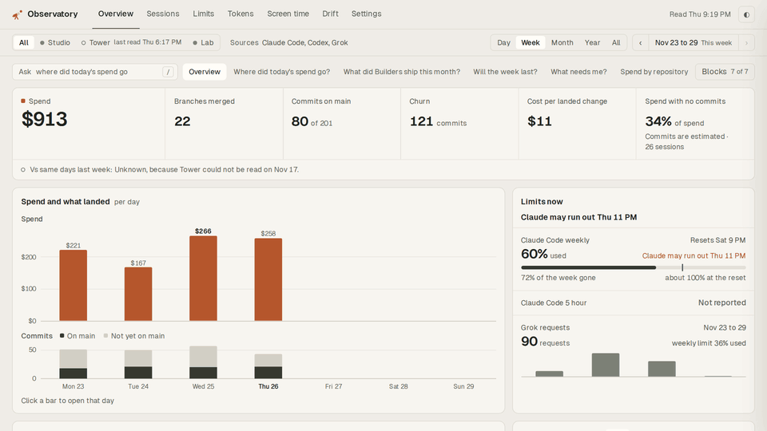
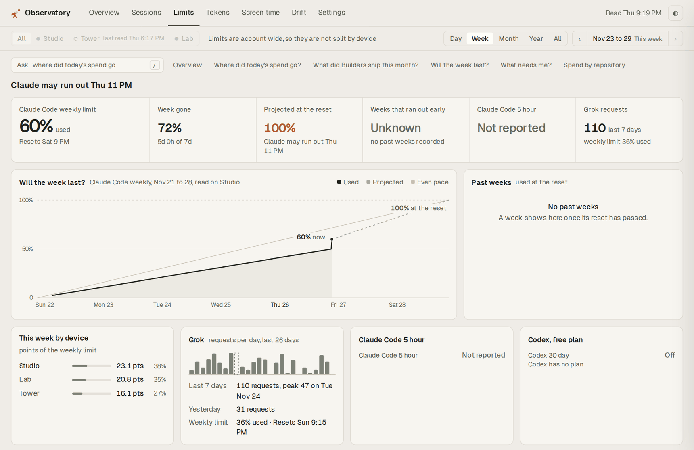
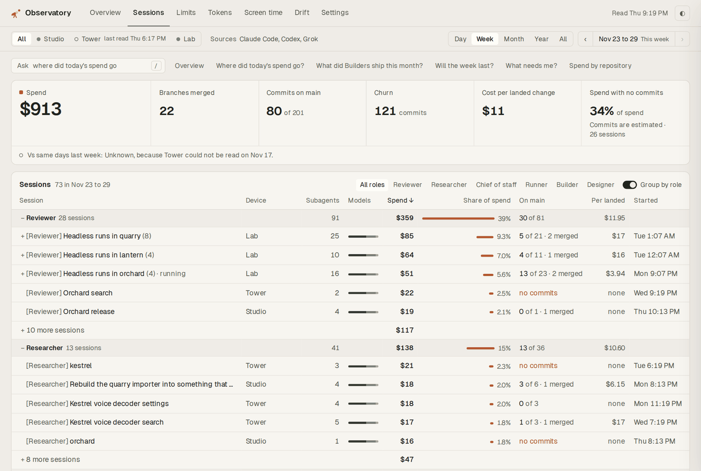

<p align="center"><picture><source media="(prefers-color-scheme: dark)" srcset="glance/icons/png/icon-128-dark.png"></picture></p>

# Observatory

A menu bar app and local dashboard that shows where your Claude Code and Codex usage went, what it shipped, and when each plan limit runs out at your current pace.

<p align="center"><picture><source media="(prefers-color-scheme: dark)" srcset="docs/images/overview-breakdown-dark.gif"></picture></p>

It reads records your tools already keep on your computer. It has no account, no hosted service and no telemetry, and nothing in it calls a model. It only watches: it does not start, stop or answer an agent, and it does not change the tools it reads. It runs on a Mac, a Windows PC, a Linux computer or any mix of them.

Try the dashboard with fictional data: [scriblesean.github.io/observatory](https://scriblesean.github.io/observatory/).

## What you see

The menu bar icon (a tray icon on Windows) is a telescope whose tube fills for the share of the Claude weekly limit used. The star shows the pace: a dot when the limit lasts until the reset, a bar when it runs out first, a hollow dot when the last reading is old. Its panel shows the scarcer limit, what is running now and the top flag, with **Open dashboard** and **Refresh**.

The dashboard has seven views: Overview, Sessions, Limits, Tokens, Screen time, Drift and Settings. A scope bar picks the computers and the period (day, week, month, year or all). Every headline number opens into its parts, and the address keeps the scope, so you can bookmark a view. The Ask field and pinned questions, such as "Will the week last?", rearrange the same blocks.

<p align="center"><picture><source media="(prefers-color-scheme: dark)" srcset="docs/images/limits-dark.png"></picture></p>

Limits leads with the forecast, for example "Claude may run out Thu 11 PM", then shows each limit window, the week's burn and past weeks.

<p align="center"><picture><source media="(prefers-color-scheme: dark)" srcset="docs/images/sessions-dark.png"></picture></p>

Sessions lists every session as "[Role] what it worked on", with its computer, models, subagents, spend and commits on main. Recurring and headless runs fold into one row.

The screenshots use the fictional sample data from `npm run preview`.

## Install

You need [Node.js](https://nodejs.org/) 22.13 or later on a Mac, or 22.17 or later on Windows. On a Mac, also run `xcode-select --install`. For screen time, install and run [ActivityWatch](https://activitywatch.net/).

```bash
git clone https://github.com/ScribleSean/observatory.git
cd observatory
npm run setup
```

Setup writes a settings file, builds the dashboard and the menu bar app (a tray app on Windows) inside the folder, and starts it now and at login. Click the telescope, then **Open dashboard**. The dashboard runs at http://127.0.0.1:5601, listens on 127.0.0.1 only and accepts only GET and HEAD requests.

- Preview what setup will do: `npm run setup -- --dry-run`.
- Update: `git pull`, then `npm run setup`.
- Remove: `npm run setup -- --remove`, then delete the folder. History stays in `~/Library/Application Support/Observatory` on a Mac and `%LOCALAPPDATA%\Observatory` on Windows until you delete it.
- On Linux, setup installs a systemd user timer that collects every five minutes and builds no app.
- If the notch hides the icon on a MacBook, hold Command and drag it right.

## Sign in

Claude limits are read through the Claude Code you already use, so Claude Code must be signed in with a Claude subscription. When it is signed out, the icon reads **Sign in** and the panel offers **Sign in to Claude**, which runs `claude auth login --claudeai`. On Linux, run that command yourself.

`npm run doctor` lists what stands between this computer and a reading, with a fix for each. It only reads. For networks with their own certificate authority, see [Settings](docs/SETTINGS.md#networks-with-their-own-certificate-authority).

## What it reads and keeps

Every five minutes it takes one snapshot of this computer:

| Source | Read from | Kept |
| --- | --- | --- |
| Limits | The installed Claude Code and Codex clients, with your existing sign-in | Percent left and reset time per window |
| Claude Code | `~/.claude/projects` | Tokens per day, hour and model. Per session: its title, times, tokens, models, subagent counts and the names of the repositories it wrote to |
| Codex | `~/.codex` | Tokens per day and model, effort and speed settings, tool call counts, and the same per-session facts where Codex records them |
| Commits | The local git repositories a session wrote to | Commit counts per session and whether they reached the default branch (estimated) |
| Screen time | ActivityWatch on 127.0.0.1 | Seconds per app and category, and per app or site your own rules name ([Screen time](docs/SCREEN-TIME.md)) |
| Grok (optional) | Local files you name | Percent left, reset time and requests per day |

Snapshots hold no prompts, responses, commands, window titles, paths or credentials. Session titles are kept so the dashboard can name sessions. Set `"sessions": { "titles": false }` to keep a short hash instead. A private cache in the data folder holds file locations so the collector can resume reading where it stopped. It does not leave the computer. [SECURITY.md](SECURITY.md) has the full list.

A value that could not be read shows as Unknown, not zero. Dollar figures are estimates at public API prices, not a bill. History goes back to the first day each source has data and stays until you delete the data folder.

## Settings

Settings live in `observatory.config.json`, next to `package.json`. A source is read only while it is `true`. Run `npm run setup` after a change.

```json
{
  "device": { "name": "Mac" },
  "sources": {
    "screenTime": true,
    "codex": true,
    "codexLimits": true,
    "claudeCode": true,
    "claudeLimits": true
  }
}
```

[Settings](docs/SETTINGS.md) covers every option: engines, Grok, session roles, certificates, the self-check and the raw archive.

## More

- [Several computers](docs/SEVERAL-COMPUTERS.md): combine a Mac, a Windows PC and a Linux computer into one view over your own SSH connection.
- [Agent status](docs/AGENT-STATUS.md): `npm run status -- --json` prints each engine's limits for scripts, and `--wait codex` waits until Codex has room.
- [Compose views with Claude](docs/MCP.md): an optional MCP server lets your own Claude client save a dashboard view from a question. It cannot read your usage.
- [Raw archive](docs/RAW-ARCHIVE.md): keep every reading as JSON Lines.

## Development

```bash
npm ci
npm test
```

`npm run tick` runs one collection. After `npm run build`, `npm run preview` serves the dashboard with fictional data at http://127.0.0.1:5602. See [CONTRIBUTING.md](CONTRIBUTING.md) and [SECURITY.md](SECURITY.md).

[MIT license](LICENSE) · [Third-party notices](THIRD-PARTY-NOTICES.md)
